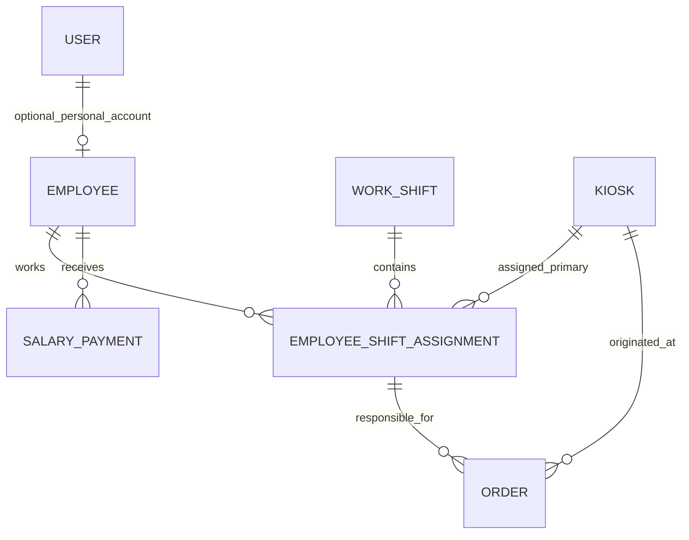

# Mini HR, ca làm, lương và nhân viên trên hóa đơn — LEADER-HR-01

**Baseline:** `origin/main@408d8f598e09e023d4f1eb23629cd2a93ef9dd44`. **Trạng thái:** Domain/EF schema và migration mới đã scaffold; Employee/Shift/Salary API, checkout integration, CMS và WPF UI chưa triển khai. SQL runtime chưa xác minh. Đây là contract bàn giao, không phải bằng chứng E2E PASS.

## 1. Quyết định và ranh giới ứng dụng

`LEADER-HR-01`, `LEADER-HR-KIOSK-01`, `LEADER-HR-RECEIPT-01` và `HR-POS-SHIFT-01` được Leader duyệt. Một ca có nhiều nhân viên; Admin nhập giờ thực tế và chốt ca. POS dùng tài khoản quầy chung, chọn nhân viên trong ca đang hoạt động một lần cho phiên bán. Kiosk tự phục vụ không có lựa chọn nhân viên: Backend giải quyết người phụ trách máy theo ca. Cả hai Order lưu snapshot mã/tên nhân viên khi tạo Pending; cả hai receipt đọc snapshot đó. Không thêm PIN, check-in/out, camera integration, thuế, bảo hiểm hoặc tự chuyển lương.

`Orders.UserId` tiếp tục chỉ tài khoản CMS/JWT tạo đơn, không đồng nghĩa nhân viên được chọn. Tài khoản POS chung không map vào một Employee. Chỉ JWT tài khoản cá nhân map duy nhất qua `Employees.UserId` mới được xem lương cá nhân Paid.

## 2. Schema và giới hạn ràng buộc

Migration mới `AddMiniHrShiftsAndOrderEmployeeSnapshots` bổ sung `Employees.EmploymentType` (1 FullTime, 2 PartTime; legacy backfill 1), `HourlyRate decimal(18,0)`; `SalaryPayments.EmploymentTypeSnapshot`, `WorkedHoursSnapshot decimal(7,2)`, `HourlyRateSnapshot decimal(18,0)`; `Orders.EmployeeShiftAssignmentId`, `KioskId`, `EmployeeCodeAtTime varchar(50)`, `EmployeeNameAtTime nvarchar(255)`. Các cột Order nullable cho dữ liệu cũ và đơn chưa có phân công. Không sửa migration HR lịch sử.

`WorkShifts`: tên, ngày bắt đầu địa phương, giờ bắt đầu/kết thúc, status Open/Finalized/Cancelled, actor và UTC time chốt. `EmployeeShiftAssignments`: ca, nhân viên, `AssignedKioskId` nullable, giờ thực tế nullable, active, note. Unique `(WorkShiftId, EmployeeId)` và filtered unique `(WorkShiftId, AssignedKioskId)` khi Kiosk khác null và assignment active. Một nhân viên phụ trách chính tối đa một máy mỗi ca; các người hỗ trợ máy không được biểu diễn như người phụ trách chính. Một máy có tối đa một người phụ trách chính trong cùng ca. Ca chồng thời gian giữa nhiều WorkShift không thể được DB unique bảo vệ: Backend phải tìm tất cả ca hợp lệ trong transaction và yêu cầu đúng một assignment cho từng Kiosk. Không chọn theo thứ tự ID.

FK ca, nhân viên, Kiosk và Order assignment dùng `RESTRICT`. Không xóa cứng Employee, ca hay assignment được tham chiếu. Unique EmployeeCode/UserId filtered và unique kỳ lương hiện hữu vẫn giữ. DB check enum, tiền/giờ không âm và status; điều kiện thời gian, active, cross-table, công thức lương, bảo vệ Paid thuộc Backend. `WorkedHours <= 744` là trần kỹ thuật; Backend còn phải kiểm giới hạn theo ca. Ngày ca qua đêm là ngày bắt đầu, `EndTime <= StartTime` được hiểu là ngày kế tiếp. Những quy tắc nghiệp vụ bổ sung này cần Leader duyệt trước khi kích hoạt API.

## 3. Ca và lương

Admin tạo ca Open, phân công nhiều nhân viên, nhập giờ từng người và chốt. Chỉ assignment active thuộc ca Finalized có giờ hợp lệ mới góp vào lương Part-time. Không cho sửa giờ đã góp vào SalaryPayment Paid; Draft phải tính lại nếu nguồn giờ/rate thay đổi. Full-time dùng `CurrentBaseSalary`; Part-time dùng tổng giờ ca Finalized trong kỳ × `HourlyRate`. Backend chụp employment type, giờ, rate, base amount vào SalaryPayment, rồi tính `NetSalary = BaseSalarySnapshot + AllowanceAmount - DeductionAmount`. Đề xuất làm tròn VNĐ một lần sau phép nhân bằng `MidpointRounding.AwayFromZero`; cần Leader xác nhận. Không tin NetSalary client gửi.

Giữ `HR-DEC-01/02/03`: tháng 1–12, năm 2000–2100, unique employee/year/month; Draft không có actor/time Paid; chỉ Admin chuyển Draft→Paid atomically với actor JWT và UTC server; concurrent pay chỉ một lần; Paid bất biến. Manager/Staff chỉ xem own Paid khi có JWT cá nhân map Employee. Không có mapping thì deny.

## 4. POS và Kiosk identity

POS GET ca hiện tại trả đúng assignment active/Employee active. Nếu nhiều ca cùng hoạt động, người bán chọn ca rõ. FE giữ lựa chọn cho phiên; đổi người/ca, hết ca hoặc assignment mất hiệu lực thì chọn lại. Checkout gửi `assignmentId`; Backend kiểm tra lại trong transaction và snapshot EmployeeCode/FullName lúc tạo Order Pending. Đổi lựa chọn sau đó chỉ ảnh hưởng Order mới. Nếu Pending chọn nhầm, hủy/tạo lại; confirm/Paid không âm thầm đổi người phụ trách.

Kiosk lấy `KioskSettings:KioskId` từ cấu hình WPF (hiện dùng cho heartbeat), nhưng client-supplied ID chưa là xác thực thiết bị. Checkout contract dự kiến gửi mã máy; Backend phải ràng buộc ID đó với credential riêng từng máy, hoặc network/device registration được kiểm tra độc lập, rồi tìm đúng một assignment active có `AssignedKioskId` trong ca đang hoạt động tại thời điểm tạo Order. Không nhận EmployeeId từ WPF. Nếu ID không hợp lệ, không có/mâu thuẫn phân công, Employee inactive, Backend không gán mã giả hoặc chọn ngẫu nhiên. **Chính sách go-live còn cần Leader duyệt:** chặn checkout mới bằng lỗi cấu hình rõ ràng và giữ nguyên đơn Pending/thanh toán đã tạo; chỉ bật yêu cầu bắt buộc sau khi credential, ca và phân công đã được vận hành/QA. Không retroactively thay đổi Order cũ. Nếu ca chuyển khi Pending, Order giữ snapshot ban đầu.

`Orders.KioskId` truy vết máy. `EmployeeShiftAssignmentId` truy vết ca/người; snapshot code/name bảo vệ hóa đơn khi hồ sơ đổi hoặc nhân viên nghỉ. Khi sửa phân công đã có Order, không được xóa hoặc sửa identity ca/máy làm thay đổi lịch sử; cần Backend guard. Receipt POS (`PosReceiptDto`) và Kiosk (`ReceiptDto`) đều dự kiến thêm `employeeCode`, `employeeName` nullable cho legacy. POS có thể có label “Thu ngân”, Kiosk “Nhân viên phụ trách”; không expose salary, phone, email, UserId hoặc EmployeeId cho WPF. CMS POS hiện ghi đè CashierName bằng tên user đăng nhập; FE phải bỏ hành vi đó sau khi Backend trả snapshot. Không thay đổi luồng thanh toán và trạng thái Order hiện hữu.

## 5. API dự kiến — chưa triển khai

Tất cả dùng `ApiResponseDto<T>` hiện hữu; 400 input sai, 401 thiếu auth, 403 sai quyền, 404 không tồn tại, 409 xung đột trạng thái/unique.

| Method | Route | Role | Request / Response và validation chính |
|---|---|---|---|
| GET/POST | `/api/employees` | Admin | Filter/paging hoặc tạo hồ sơ; code/UserId unique, type/rate hợp lệ |
| GET/PUT/PATCH | `/api/employees/{id}` / `{id}/status` | Admin | Chi tiết, cập nhật, vô hiệu hóa; không hard delete |
| GET/POST | `/api/work-shifts` | Admin | Lọc ngày/status hoặc tạo ca |
| PUT | `/api/work-shifts/{id}` | Admin | Sửa ca Open chưa khóa lịch sử |
| PUT | `/api/work-shifts/{id}/assignments` | Admin | Phân công, AssignedKioskId, giờ, active; unique và conflict |
| POST | `/api/work-shifts/{id}/finalize` | Admin | Chốt actor/time; thiếu giờ hoặc đã chốt trả 409 |
| GET | `/api/pos/active-shifts` | Admin, Staff | Ca hiện tại và nhân viên hợp lệ; không fallback toàn bộ |
| GET/POST | `/api/salary-payments` | Admin | Lọc kỳ hoặc tạo Draft do Backend tính |
| GET/PUT | `/api/salary-payments/{id}` | Admin; own Paid GET theo JWT cá nhân | Chi tiết/sửa Draft; row ownership |
| POST | `/api/salary-payments/{id}/pay` | Admin | Draft→Paid atomic, 409 khi cạnh tranh |
| GET | `/api/salary-payments/me` | Manager, Staff tài khoản cá nhân | Chỉ own Paid; shared POS không dùng selected employee |

Mở rộng checkout POS hiện hữu nhận `assignmentId`; Kiosk checkout dự kiến nhận định danh Kiosk được xác thực riêng; Order detail/receipt trả snapshot. Không tạo Employee/Salary/ca endpoint chỉ vì schema đã có. DTO cụ thể: `EmployeeDto`, `WorkShiftDto` với `AssignmentDto`, `SalaryPaymentDto`, `PosReceiptDto` và `ReceiptDto` mở rộng. Backend lấy actor và employee snapshot từ dữ liệu server.

## 6. QA, migration và handoff

**Schema có thể kiểm tĩnh:** HR-DB-01..08: migration additive; FK/unique/check; nullable legacy Order; snapshot EF nhất quán. SQL apply/rollback chỉ trên QA disposable được xác minh. **API/FE chưa chạy:** HR-POS-01..07, HR-KIOSK-01..10, SAL-01..13 và các ca Full-time/Part-time, giờ lẻ, ca Finalized, concurrency, row ownership. Không đánh dấu PASS từ schema scaffold.

**Backend @thien33:** Employee API → Shift/Assignment API → POS validation và snapshot → Kiosk device validation/responsibility resolution → Salary Draft/Paid → receipt DTO/API → unit/API/security/concurrency tests. **Frontend @lehuukhang:** CMS Employees → CMS Shifts → POS chọn người trong ca/receipt → CMS Salary → WPF Kiosk receipt chỉ hiển thị mã/tên Backend trả → integration tests. **Leader @Unknown4505:** schema/migration/contract, SQL QA, độc lập QA và E2E. Kiosk không có UI chọn nhân viên. Các GitHub issues chỉ là draft; không mở rộng #103–#108.

## 7. Quyết định còn chờ trước khi bật production

1. Credential định danh riêng cho từng Kiosk và chính sách cấp/thu hồi; `KioskId` trong JSON hoặc heartbeat hiện chưa đủ tin cậy.
2. Chặn checkout mới khi thiếu/mâu thuẫn phân công Kiosk; thời điểm bật gate sau khi backfill cấu hình/QA.
3. Quy tắc ca qua nửa đêm, ca chồng giờ và giới hạn giờ thực tế.
4. Làm tròn tiền giờ lẻ; khóa/điều chỉnh nguồn giờ sau Draft/Paid.
5. Một nhân viên phụ trách chính tối đa một Kiosk mỗi ca theo schema tối giản; nếu cửa hàng cần nhiều máy/người, phải xét bảng mapping riêng.

## 8. GitHub issue drafts — chưa tạo issue

| Title | Owner | Priority | Dependencies | Files dự kiến | Scope và acceptance |
|---|---|---|---|---|---|
| HR-DB SQL disposable verification | @Unknown4505 | P0 | Migration mới | Infrastructure/Migrations, QA evidence ngoài project | Apply/rollback trên DB disposable; HR-DB-01..08 PASS, legacy Orders còn đọc được |
| HR Employee API | @thien33 | P0 | HR-DB | API/Controllers, Application/Services/DTOs, Infrastructure/Repositories | Admin CRUD/status; unique EmployeeCode/UserId; không hard delete; 400/403/404/409 tests |
| HR Shift/Assignment API | @thien33 | P0 | Employee API | API, Application, Infrastructure | Nhiều nhân viên/ca; một primary/Kiosk/ca; finalize; overlap conflict; inactive/paid guards; API tests |
| HR Salary Draft/Paid API | @thien33 | P0 | Shift API | API, Application, Infrastructure | Full-time/Part-time snapshot, SAL-01..13, atomic Pay và row authorization |
| HR POS employee resolution | @thien33 | P0 | Shift API | OrdersController, OrderService, Order DTOs | Valid assignment tại checkout; snapshot Pending; không tin name/code client; HR-POS-01..07 |
| HR Kiosk device/responsibility resolution | @thien33 | P0 | Shift API, device credential decision | Kiosk/Orders API, Application | Xác thực máy; đúng một active primary; lỗi cấu hình rõ; không giả mã; HR-KIOSK-02..04,08..10 |
| HR receipt backend contract | @thien33 | P0 | POS/Kiosk resolution | PosReceiptDto, ReceiptDto, OrderService | Hai receipt đọc cùng Order snapshot, legacy nullable; HR-POS-07, HR-KIOSK-05..07 |
| HR Backend automated QA | @thien33 | P0 | BE tasks | Bộ test ngoài project theo quy ước Leader | Unit/API/security/concurrency; evidence và exact HEAD |
| HR Employee CMS | @lehuukhang | P0 | Employee API | CMS Controllers/Views/Models | CRUD/status với API thật; tiền chỉ Admin thấy |
| HR Shift CMS | @lehuukhang | P0 | Shift API | CMS Controllers/Views/Models | Phân công, Kiosk primary, nhập giờ, chốt; không cho sửa Paid source |
| HR Salary CMS | @lehuukhang | P0 | Salary API | CMS Controllers/Views/Models | Draft/Paid và lịch sử trên một màn hình; không tính tiền ở FE |
| HR POS selection and receipt | @lehuukhang | P0 | POS BE/receipt | CMS Pos Views/Controller/Models | Chỉ assignment ca hiện tại; giữ lựa chọn theo phiên; bỏ override CashierName; mã/tên snapshot |
| HR WPF Kiosk receipt | @lehuukhang | P0 | Receipt BE | Kiosk Receipt DTO/View | Chỉ hiện/in employeeCode/name server trả; không có chọn nhân viên trên WPF |
| HR FE integration QA | @lehuukhang | P0 | FE tasks | Bộ test ngoài project theo quy ước Leader | CMS/Kiosk integration evidence, không dùng mock để kết luận E2E |
| HR independent E2E | @Unknown4505 | P0 | Tất cả API/UI, device credential | docs/11 và QA evidence | Employee→Shift→POS/Kiosk→Receipt→Salary trên SQL QA; không regression thanh toán |
